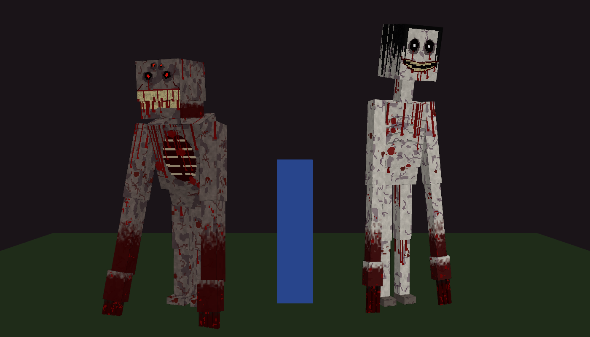

# ECO v2.1.0: terror para Minecraft Bedrock

## ⬇️ Descargar
**[Descargar ECO.mcaddon](https://github.com/onlyclaude455-star/eco-minecraft/raw/main/ECO.mcaddon)**

En el iPhone: toca el enlace → Descargar → abre la app Archivos → toca `ECO.mcaddon` → Compartir → Minecraft.

Archivo para instalar: `ECO.mcaddon` (en la raíz del repositorio). Contiene el paquete de comportamiento y el de recursos.
Para regenerarlo después de cambiar algo: `python3 tools/build.py`. Hace falta Python con numpy y Pillow, espeak-ng y ffmpeg.

## Instalación en el iPhone
1. **Borra cualquier versión anterior de ECO** (también la 2.0.0). Ve a Configuración → Almacenamiento y borra los paquetes ECO viejos. Si quedan dos versiones instaladas, el mundo puede seguir usando la vieja.
2. Abre `ECO.mcaddon` con Minecraft (Compartir → Minecraft). Deben aparecer dos mensajes: "importación correcta".
3. En el mundo, ve a **Paquetes de comportamiento** y activa **ECO Comportamiento**. El paquete de recursos se activa solo porque el de comportamiento depende de él. Si te pregunta, acepta activar también el de recursos.
4. No hace falta activar ningún experimento.
5. Si algo falla: Configuración → Creador → activa el **Registro de contenido (GUI)**. Los errores salen en pantalla. Hazles captura.

## Las entidades
- **El Testigo**: pálido, de 3,2 a 4,4 bloques de alto (cada uno sale de una altura distinta). Tiene pelo negro mojado, ojos hundidos con pupilas que brillan, lágrimas de sangre y una sonrisa cortada de oreja a oreja.
  - Te observa desde lejos y desaparece si lo miras fijamente o te acercas.
  - Se acerca cuando no lo miras y se congela cuando lo miras.
  - Aparece justo detrás de ti y respira. Si te giras, desaparece con un chirrido. Si no te giras, te golpea.
  - Si le pegas, se ríe, se va… y vuelve detrás de ti.
- **El Imitador**: encorvado, de 3 a 4 bloques. Tiene cuatro ojos rojos que brillan, el pecho abierto con costillas y una mandíbula llena de dientes que se abre cuando se revela.
  - Lleva encima el nombre de un amigo (o el tuyo si juegas solo) y escribe en el chat con ese nombre.
  - Habla con voz ("oye, ven aquí", "ábreme la puerta") e imita ruidos: puertas, cofres, pasos, comer.
  - Si te acercas o le pegas, grita, abre la boca, levanta los brazos y te persigue.
- Las dos van **sangrando** (partículas que caen al suelo) y dejan **rastros**: gotas de redstone y carteles carmesí con mensajes en rojo.

## Qué pasa cada noche
ECO funciona **todas las noches** y la cosa empeora con cada una. De día también pasan cosas, más pequeñas.

- **Noche 1** (guion fijo, ~8 min): susurro → pasos detrás → ojos rojos → El Testigo a lo lejos → puertas → **aparece un instante pegado a tu cara** → cartel → respira detrás de ti y te golpea → **apagón** → **se asoma** desde una esquina → voz falsa → se acerca cuando no miras → rastro de sangre → **tu cámara gira sola** hasta mirarlo → persecución.
- **Noche 2**: sustos fuertes al azar, niebla oscura, saca cosas de tus cofres, te golpea.
- **Noche 3**: llega El Imitador. También mensajes falsos del sistema y "tú" escribes en el chat cosas que no escribiste.
- **Noche 4 en adelante**: las dos entidades y más sustos.
- **Noche 5: LA LUNA ROJA** (después, cada noche tiene un 20 % de probabilidad, y siempre las noches 10, 20, 30…).

Dentro de casa, el director elige los sustos de interior (esquinas, ventanas, puertas, cofres). Al aire libre elige los de exterior (círculos, relámpagos, persecuciones).

## Los sustos
| Susto | Qué pasa |
|---|---|
| **Apagón** | Las antorchas y faroles se apagan uno a uno, del más lejano al más cercano, y una voz dice "estoy aquí" desde cada uno. Al final dice "más cerca…". Oscuridad total, un coro de susurros, silencio… y algo aparece. |
| **Asomarse** | En casas y cuevas, una entidad se inclina desde detrás de una pared, una puerta o una esquina, con la cabeza torcida. Si la miras, se esconde (o se lanza a por ti). Si apartas la vista, ya no está y te susurra "estoy aquí". |
| **Cámara que gira sola** | Te quedas sin control y tu cámara se da la vuelta despacio… hasta que tienes delante a El Testigo. |
| **Parpadeo** | Aparece pegado a tu cara durante 0,3 segundos y desaparece. Sin aviso y sin ruido. |
| **Golpes en la puerta** | Llaman tres veces. Luego más fuerte y la pantalla tiembla. "ábreme". La puerta se abre sola y hay algo agachado detrás. |
| **Ventana** | Una cara mirándote desde fuera. A veces rompe el vidrio y dice "ya estoy dentro". |
| **Pregunta** | Te sale una ventana en pantalla: "¿Estás solo?" (o "¿Puedo entrar?"). Respondas lo que respondas: "mentiroso"… y lo tienes detrás. |
| **Cama** | Si intentas dormir de noche, a veces te despierta "abre los ojos" y la tienes delante. Junto a la cama queda un cartel: "NO DUERMAS". |
| **Relámpago** | Con el destello se ve una figura que no estaba ahí. |
| **Mensajes falsos** | "El Testigo se ha unido a la partida". Si juegas con amigos: "(amigo) ha abandonado la partida"… y luego vuelve a "entrar" y pregunta "¿me extrañaste?". |
| **Tu muerte** | Donde mueres queda un cartel con tu nombre: "(NOMBRE) AQUÍ". |

## De día
Desde el primer amanecer, cada pocos minutos:
- una figura a lo lejos;
- un cartel nuevo;
- un **"regalo"** detrás de ti: carne podrida llamada "Tu corazón", un papel con "Página arrancada", una amapola "Para ti" ("Te miré dormir toda la noche")…;
- un **animal de tu granja muerto** junto a un cartel: "ERES EL SIGUIENTE" (nunca toca las mascotas domesticadas);
- risas, pasos dentro de casa, objetos cambiados de sitio.

## La luna roja
La peor noche. Los mismos sustos, pero mucho más seguidos (cada 9–16 segundos) y con la pausa entre sustos grandes reducida:
- Aviso la tarde anterior: "esta noche…", carteles "LA LUNA SALE ROJA" y el aviso "El cielo tiene un color extraño".
- Al anochecer: destello rojo, título **LA LUNA ROJA – ya no se esconden**, coro de susurros, "El Testigo se ha unido a la partida", "El Imitador se ha unido a la partida".
- Se apagan todas las luces a tu alrededor y se abren todas las puertas.
- Niebla roja, ceniza, **lluvia de sangre**, tormenta y latido constante.
- **Círculo**: de 4 a 6 Testigos te rodean. Solo se mueven cuando no los miras ("no parpadees"). Uno de ellos termina en susto.
- **Portazos**: todas las puertas de la casa se abren y se cierran de golpe a la vez, una y otra vez.
- Cuando estás a punto de dormir, te despiertan siempre.
- Al amanecer: "Sobreviviste… por ahora", y estás rodeado de 6 carteles: "TE VI".

## Comandos de prueba
Todos empiezan por `/scriptevent eco:` y necesitan tener los trucos activados.

| Comando | Qué hace |
|---|---|
| `eco:ayuda` | Lista de comandos |
| `eco:estado` | Noches, fase, si estás "dentro" y entidades activas |
| `eco:testigo detras` (`lejos`, `acecho`, `caza`) | Invoca a El Testigo en ese modo |
| `eco:imitador` | Invoca a El Imitador (mejor al aire libre) |
| `eco:susto` | Susto: aparece delante, te bloquea la cámara y grita |
| `eco:luna` | Empieza la luna roja (si es de día, hace de noche primero) |
| `eco:evento <nombre>` | Sustos: `apagon`, `asomarse`, `camara_giro`, `parpadeo`, `golpes_puerta`, `ventana`, `formulario`, `rayo`, `circulo`, `portazos`, `mensaje_sistema`, `auto_chat`. Otros: `susurro`, `pasos`, `ojos`, `puertas`, `antorchas`, `cofre`, `inventario`, `cartel`, `rastro`, `golpe`, `voz_falsa`, `risa`, `regalo`, `animal_muerto` |
| `eco:fase 1`–`4` (`0` = automática) | Fuerza la fase |
| `eco:noche` / `eco:noche roja` / `eco:dia` | Cambia la hora |
| `eco:limpiar` | Quita las entidades activas |
| `eco:reiniciar` | La próxima noche vuelve a ser la noche 1 |

En el menú creativo también hay huevos de generación ("Generar El Testigo", "Generar El Imitador").
